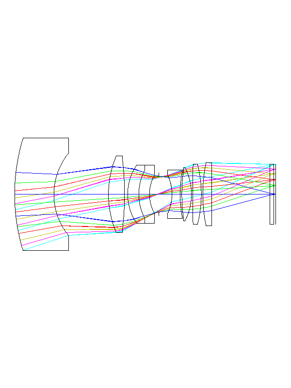

# 示例：2/3" 5MP 16mm F/2.0 C口高分辨率工业定焦镜头自动化设计

本目录记录了基于 **Zemax-mcp + Ansys Zemax OpticStudio Interactive Extension** 完成工业级定焦镜头自动化建模、多轮结构演进、评价函数（MFE）调优与高精度复验的完整工程案例。



## 1. 设计规格与指标要求

- **传感器规格**：2/3" CMOS，像元尺寸 $3.45\ \mu\text{m}$，$2448 \times 2048$，成像圆 $\Phi 11.0\ \text{mm}$（半像高 $Y' = 5.5\ \text{mm}$），探测器前带 $0.7\ \text{mm}$ `N-BK7` Cover Glass，传感器奈奎斯特频率 $f_N = 145\ \text{lp/mm}$。
- **工作波段**：可见光 F / d / C（$486.1\text{--}656.3\ \text{nm}$，主波长 $587.6\ \text{nm}$）。
- **一阶与机械边界**：
  - 有效焦距 $\text{EFL} = 16.0\ \text{mm} \pm 2\%$（$15.68\text{--}16.32\ \text{mm}$）
  - 工作 $F/\# = 2.0$，半视场角 $19.0^\circ$（全视场约 $38^\circ$，采样 `0.0° / 5.7° / 9.5° / 13.3° / 16.15° / 19.0°`）
  - 光学总长 $\text{TOTR} \le 48.0\ \text{mm}$，等效空气后工作距 $\text{BFL} \ge 11.5\ \text{mm}$，最大透镜外径 $\le 26.0\ \text{mm}$（半口径 $\le 13.0\ \text{mm}$）
- **成像质量目标（$F/2.0$ 全开、无渐晕）**：
  - MTF @ $145\ \text{lp/mm}$：$0.0\text{F} \ge 0.45$（且 @ $72\ \text{lp/mm} \ge 0.65$），$0.7\text{F} \ge 0.35$，$1.0\text{F} \ge 0.25$
  - 畸变 $< 0.5\%$，垂轴色差 `LACL` $< 1.5\ \mu\text{m}$，相对照度 $\ge 65\%$，CRA $< 8^\circ$
- **可制造性约束**：6–8 片全玻璃标准球面镜片（**无非球面**，允许 1–2 组双胶合），SCHOTT 标准玻璃库，中心厚 $\ge 1.5\ \text{mm}$，边厚 $\ge 1.2\ \text{mm}$，空气隙 $\ge 0.25\ \text{mm}$（光阑前后 $\ge 1.5\ \text{mm}$）。

---

## 2. 初始结构选型与自动化优化过程

整个过程均通过 `zemax_cli.py` 驱动 OpticStudio 自动化迭代：

1. **排除 Cooke 三片式与传统 6~7 片双高斯**：
   - 测试 6 片及拆分末片的 7 片双高斯（[zmx/stage4_7el_nsf5.zmx](zmx/stage4_7el_nsf5.zmx)）发现：对称双高斯在满足长后焦（$\ge 11.5\ \text{mm}$）时很难兼顾 $19^\circ$ 大孔径斜球差与像散，7 片结构优化后 $19^\circ$ @ $145\ \text{lp/mm}$ MTF 仅 `0.058`。
2. **确立 8 片“反远距-双高斯复合”架构**：
   - 采用“前负弯月镜 `L1 (N-F2)` + 长空气隙 + `L2 (N-LAF34)` + 胶合组 `L3-L4 (N-SK16 + N-SF10)` + `Stop` + `L5-L6` + 后场镜 `L7, L8 (N-LAF34)` + `Cover Glass`”（[configs/init_16mm_f2_8el_retro.json](configs/init_16mm_f2_8el_retro.json)）。
   - 在 [zmx/stage10_8el_axis_pass.zmx](zmx/stage10_8el_axis_pass.zmx) 中，通过注入多色波前质心 `RWCE` 操作数压倒默认 `SEQOptimizationWizard` 权重，轴上 MTF @ $145\ \text{lp/mm}$ 达到 **`0.4678`**，但胶合后组 `L5-L6` 导致 `LACL = 8.311 μm`（超过半周期 $3.45\ \mu\text{m}$），边缘 $19^\circ$ MTF 仅 `0.1822`。
3. **关键结构突破：拆分 `L5/L6` 为空气分离 + `RWCE/RSCE/LACL` 协同平衡**：
   - 将后双高斯胶合组 `L5-L6` 拆分为空气分离（[configs/init_8el_airspaced.json](configs/init_8el_airspaced.json) -> [zmx/stage11_airspaced.zmx](zmx/stage11_airspaced.zmx)），`LACL` 减半至 `4.038 μm`，$19^\circ$ MTF 跃升至 `0.2988`。
   - 发现仅用 `RWCE` 时，接近的 RMS 波前下边缘高斜率球差仍会拉低高频 MTF；遂采用 **多色波前 `RWCE` + 多色点列 `RSCE` + 高权重 `LACL`（最高 3,500,000）+ `CTGT(16)`（锁等效空气 BFL $\ge 11.5\ \text{mm}$）** 进行多轮平衡与厚度锁定 Hammer 玻璃库验证（[zmx/stage17_mid.zmx](zmx/stage17_mid.zmx) -> [zmx/final_16mm_f2_8el.zmx](zmx/final_16mm_f2_8el.zmx)）。

---

## 3. 阶段演化与最终验证结果

### 阶段关键指标对比

| 关键里程碑文件 | `EFFL` (mm) | `0.0°` @145 | `0.7F (13.3°)` @145 | `1.0F (19.0°)` @145 | `LACL` (μm) | 备注 |
| :--- | :---: | :---: | :---: | :---: | :---: | :--- |
| [zmx/stage4_7el_nsf5.zmx](zmx/stage4_7el_nsf5.zmx) | — | — | — | `0.058` | — | 7 片双高斯边缘受限 |
| [zmx/stage10_8el_axis_pass.zmx](zmx/stage10_8el_axis_pass.zmx) | `15.959` | **`0.4678`** | `0.3435` | `0.1822` | `8.311` | 8 片胶合 `L5-L6`，轴上达标、边缘受阻 |
| [zmx/stage11_airspaced.zmx](zmx/stage11_airspaced.zmx) | `15.831` | `0.3160` | `0.3400` | **`0.2988`** | `4.038` | `L5/L6` 空气分离突破 |
| [zmx/stage17_mid.zmx](zmx/stage17_mid.zmx) | `15.951` | `0.3707` | `0.3401` | `0.2648` | `1.877` | `RWCE+RSCE` 平衡态 |
| **[zmx/final_16mm_f2_8el.zmx](zmx/final_16mm_f2_8el.zmx)** | **`16.006`** | **`0.3862`** | **`0.3258`** | **`0.2654`** | **`1.237`** | **最终定稿（Sampling 4 验证）** |

### 最终设计实测汇总（[zmx/final_16mm_f2_8el.zmx](zmx/final_16mm_f2_8el.zmx)）

- **一阶与机械尺寸**：`EFFL = 16.006 mm`（+0.04%）、`WFNO = 1.995`、`TOTR = 47.903 mm`（$\le 48.0\ \text{mm}$）、物理后距 `11.8075 mm` / 等效空气 BFL **`11.569 mm`**（$\ge 11.5\ \text{mm}$）、最大镜片直径 `20.695 mm`（$\le 26.0\ \text{mm}$）。
- **加工边界**：8 片全玻璃球面（`Conic = 0`），最小中心厚 `1.5107 mm`（`L5`），最小空气间隙 `0.2625 mm`（`L6-L7`），光阑前后间隙 `1.680 / 2.440 mm`，全表面 $|R|/\text{SD} \ge 1.571$，且施加 `MNEG >= 1.25 mm`。
- **像差与色差**：轴向色差 `AXCL = 0.837 μm`，垂轴色差 `LACL = 1.237 μm`（$< 1.5\ \mu\text{m}$）；赛德尔畸变系数 `DIST = -0.2949`，由像面半口径估算边缘畸变约 `-0.20%`（$< 0.5\%$）；无渐晕下 $\cos^4(19^\circ) \approx 80\%$。
- **全视场 MTF 实测（`mtf-sampling 4`，与 `2/3` 收敛一致）**：
  - `72.5 lp/mm`（0.0F）：**`0.7128`**（$\ge 0.65$）
  - `145 lp/mm` 全视场平均：`0.3862 (0.0°)` / `0.4458 (5.7°)` / `0.4411 (9.5°)` / `0.3258 (13.3°)` / `0.2726 (16.15°)` / `0.2654 (19.0°)`

---

## 4. 目录文件说明

- [README.md](README.md)：本示例设计需求、思路与结果说明
- [cross_section.png](cross_section.png)：OpticStudio 导出的最终二维光路截面图
- [configs/](configs/)：初始建模 JSON 配置文件（`init_16mm_f2_8el_retro.json`、`init_8el_airspaced.json`）
- [zmx/](zmx/)：关键演化阶段与最终 `.zmx` 镜头文件（`stage4_7el_nsf5.zmx`、`stage10_8el_axis_pass.zmx`、`stage11_airspaced.zmx`、`stage17_mid.zmx`、`final_16mm_f2_8el.zmx`）

## 5. 快速复现指令

启动服务端与 OpticStudio Interactive Extension 后，可直接加载并评估最终结构：

```powershell
.\.venv\Scripts\python.exe zemax_cli.py load example/zmx/final_16mm_f2_8el.zmx
.\.venv\Scripts\python.exe zemax_cli.py status
.\.venv\Scripts\python.exe zemax_cli.py evaluate --max-freq 145 --points 5 --mtf-sampling 4
.\.venv\Scripts\python.exe zemax_cli.py aberrations
```
